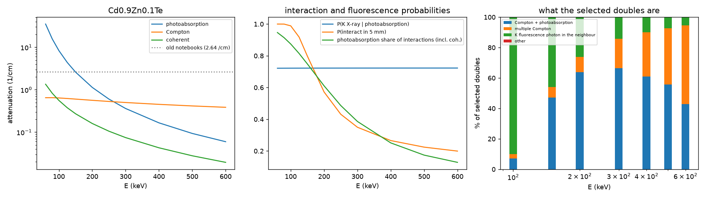
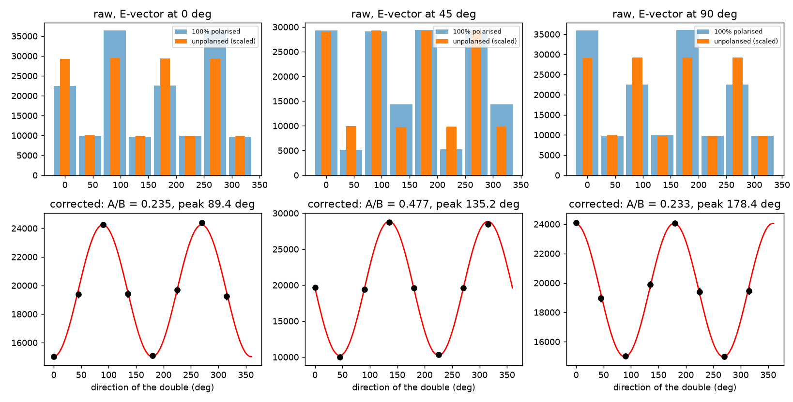

# czt_mc: Compton polarimetry in a pixelated CdZnTe detector

A small, fast, fully scripted Monte Carlo of the physics behind CZTI-style Compton polarimetry. Photons enter a 7 x 7 array of 2.46 mm pixels of 5 mm thick Cd0.9Zn0.1Te, interact,
and the pair of pixels that trigger (a *double event*) gives the azimuthal scattering direction. The package turns the 8-bin azimuth histogram of a polarised and an unpolarised beam into a
modulation curve and recovers the polarisation fraction (PF) and angle (PA) with errors.

It started as the notebooks behind a BTP report (`docs/BTP_1.pdf`) and was rewritten after a code review: the old code used one attenuation coefficient at all energies and treated every interaction
as a Compton scatter. This version has

* **energy-dependent attenuation** from the Elam tables (checked against NIST to 0.1%), split into photoabsorption, incoherent (Compton) and coherent scattering;
* **exact polarised Klein-Nishina sampling** (cos theta, then the azimuth from the E vector; no rejected photons) with the polarisation vector carried through multiple scatterings;
* **K fluorescence** of Cd, Zn and Te (real yields, lines and absorption lengths), so photoabsorption can leak an X-ray into a neighbouring pixel;
* **the CZTI double-event selection** (20 keV threshold, adjacent pixels, 100-600 keV, no upper limit on E_high/E_low) and a classification of every selected event (Compton + photoabsorption, multiple Compton, fluorescence);
* an **analysis** with geometry correction, an exact linear cosine fit, and PF and PA with covariance-based errors;
* **speed**: vectorised and parallel, about 3 million photons per second on 6 cores, identical results for any number of workers;
* 38 **tests** that encode every problem the review found.



## What it tells you

In 5 mm of CdZnTe the interaction mix changes completely over the CZTI band, and the selected doubles are not all Compton scatters:

| E (keV) | Compton : photoabsorption | doubles that are a fluorescence photon in the neighbour | doubles that are Compton + photoabsorption |
|---|---|---|---|
| 100 | 0.08 | 90% | 7% |
| 200 | 0.50 | 26% | 64% |
| 300 | 1.38 | 14% | 67% |
| 600 | 6.5 | 5.5% | 43% |

Fluorescence doubles carry no polarisation information, so they dilute the modulation, by an amount that depends on the PA. They are also what the old E_high/E_low <= 6 cut was removing.
Details: [docs/RESULTS.md](docs/RESULTS.md).



## Install and run

```bash
pip install -r requirements.txt            # numpy, scipy, matplotlib, pytest (xraydb only to rebuild the cross-section tables)
python -m pytest -q tests                  # about 15 s
python scripts/run_all.py --quick          # a few minutes; without --quick about 10 minutes on 6 cores
```

Use it from Python:

```python
from czt_mc import analysis, runner

setup = runner.Setup()                                          # geometry + cross-section tables, built once
unpol = runner.run(setup, 5_000_000, 300.0, pf=0.0, seed=1)     # photons, energy in keV
pol = runner.run(setup, 5_000_000, 300.0, pf=1.0, pa_deg=45.0, seed=2)

fit = analysis.fit_modulation(*analysis.corrected_curve(pol["hist"], unpol["hist"]))
print(fit["mu"], fit["peak"])      # modulation A/B = 0.477, peak at PA + 90 = 135 deg
print(pol["origin"])               # what the selected doubles are made of
```

`runner.run` also takes the incidence angles (`theta_inc`, `phi_inc`), the selection (`e_thr`, `e_window`, `ratio_max`), `fluorescence=False`, `mu_const` (the old constant attenuation, for comparison),
`keep_doubles=True` for the per-event arrays, and `workers` (default: all CPUs, or the `CZT_WORKERS` environment variable).

## Scripts

Everything is a script; each prints its numbers and writes a CSV (and a figure) to `results/`.

| script | what it does |
|---|---|
| `make_cross_section_tables.py` | builds `czt_mc/data/czt_xs.csv` and `czt_kfluor_lines.csv` from the Elam tables (xraydb) |
| `validate_cross_sections.py` | compares them with the NIST element tables |
| `validate_kn_sampling.py` | chi-square of the cos(theta) marginal and the azimuthal modulation per theta bin |
| `run_composition.py` | Compton : photoabsorption : fluorescence, as cross sections and as classes of selected doubles |
| `run_modulation.py` | raw and geometry-corrected 8-bin curves, fit and recovered PA |
| `run_pa_scan.py` | recovered against injected PA over 0-180 degrees |
| `run_pf_recovery.py` | injected against recovered PF and PA |
| `run_oblique.py` | oblique incidence |
| `run_legacy_comparison.py` | what the old conventions did, measured inside the corrected framework |
| `analyse_pixel_table.py` | the same selection and analysis on a per-pixel energy table (for example Geant4 / CZTPhysSim output) |
| `plot_geometry.py` | the beam, E vector and preferred scattering direction |
| `benchmark_speed.py` | throughput against the number of workers |
| `run_all.py` | tests, validations and all of the above |

## Layout

```
czt_mc/        constants, physics (cross sections, Klein-Nishina, fluorescence), detector (geometry, event selection),
               transport (vectorised photon transport), analysis (histograms, fit, PF/PA), runner (parallel runs), pixel_io, data/
scripts/       the scripts above
tests/         pytest: NIST match, KN sampling, polarisation, selection rules, fit recovery, determinism, ...
results/       CSV tables and figures written by the scripts
docs/          BTP_1.pdf (the original report), PHYSICS.md, RESULTS.md, REVIEW.md
```

## Documentation

* [docs/PHYSICS.md](docs/PHYSICS.md): material, interaction model, conventions (PA, bins, event selection) and what is not modelled.
* [docs/RESULTS.md](docs/RESULTS.md): composition tables, fluorescence dilution, PA and PF recovery, oblique incidence, old conventions against new, speed.
* [docs/REVIEW.md](docs/REVIEW.md): each finding in the original notebooks, its fix and the test that guards it.

## What it is for, and what it is not

* **Yes: a cross-check and a testbed.** It is a quick, readable companion to a Geant4 simulation such as [CZTPhysSim](https://github.com/dakshasat/CZTPhysSim): the same selection can be applied to both
  (`analyse_pixel_table.py`), event class by event class, and analysis questions (cosine fit against template fit, PF/PA bias, fluorescence dilution, selection cuts) can be answered in minutes.
* **No: not a Geant4 replacement.** There is no electron transport, charge sharing, energy resolution, Doppler broadening, coherent-scattering angles, mask, spacecraft or support structure.
  Coherent scattering is treated as no interaction and L fluorescence and Auger electrons are absorbed locally.

Known limits of the analysis: the cosine fit has a systematic PA offset of up to 10 degrees away from the symmetry axes, and oblique beams add higher harmonics; use a template fit when that matters.
`analyse_pixel_table.py` has not yet been run on a real CZTPhysSim file.
